# Five-stage pipeline and control flow

For a quick orientation, start with the compact five-stage overview in the [README](../README.md). The detailed graph below follows the implemented `rv32i_core_top` and the [technical architecture](TECHNICAL_ARCHITECTURE.md). Solid arrows show data and pipeline flow; dashed arrows show bypass or control paths. RAM outputs and pipeline packets are updated on rising edges. Parallel fetch metadata and the registered instruction word describe one IF/ID slot, not two serial registers.

```mermaid
flowchart LR
    subgraph IF["IF — fetch"]
        PC["pc_fetch: PC, issue, range check"]
        IM["imem_sync: registered instruction output"]
        PC -->|"imem_addr / imem_en"| IM
    end
    IFID["IF/ID: PC, valid, fetch-fault metadata"]
    subgraph ID["ID — decode and read"]
        DEC["decoder / imm_gen"]
        RF["reg_file: asynchronous reads"]
        BY["WB-to-ID bypass"]
        HAZ["hazard_ctrl: true load-use interlock"]
        RF --> BY
        DEC --> HAZ
    end
    IDEX["ID/EX: operands, controls, identity"]
    subgraph EX["EX — execute and accept memory"]
        FWD["forward_unit selectors / operand and store-data muxes"]
        ALU["alu: result / effective address"]
        BR["branch_unit: compare and target"]
        LSU["lsu_ex: alignment, range, byte lanes"]
        RES["EX result: ALU result or jump PC+4"]
        FWD --> ALU
        FWD --> BR
        FWD -->|"forwarded store data"| LSU
        ALU -->|"effective address"| LSU
        ALU --> RES
    end
    EXMEM["EX/MEM: result, load metadata, transaction history"]
    DM["dmem_sync: EX-ending edge accepts read or store; registered read output"]
    subgraph MEM["MEM — format and select"]
        LF["load_formatter: lane and sign/zero extension"]
        SEL["select formatted load or EX result"]
        LF --> SEL
    end
    MEMWB["MEM/WB: registered wb_data and history"]
    subgraph WB["WB — write and observe"]
        WR["wb_trace: functional register write"]
        TR["optional registered retirement trace: TRACE_EN"]
    end
    FC["fault_ctrl: EX fault before legal EX redirect before ID event; drain then halt"]
    PC -->|"accepted-slot metadata"| IFID
    IM -->|"held registered word"| DEC
    IFID --> DEC
    DEC -->|"register addresses"| RF
    DEC --> IDEX
    IDEX -->|"jump flags and PC (link = PC+4)"| RES
    BY --> IDEX
    IDEX --> FWD
    IDEX -->|"instruction controls"| ALU
    IDEX -->|"instruction controls"| BR
    IDEX -->|"instruction controls"| LSU
    RES --> EXMEM
    LSU -->|"qualified operation and load lane"| EXMEM
    LSU -->|"dmem_re / dmem_we, address, data, strobes"| DM
    DM -->|"registered load word"| LF
    EXMEM -->|"load size, lane, signedness"| LF
    EXMEM -->|"ex_result"| SEL
    SEL --> MEMWB
    MEMWB --> WR
    MEMWB --> TR
    WR -->|"rising-edge write to nonzero rd"| RF
    EXMEM -.->|"ready non-load result: highest priority"| FWD
    MEMWB -.->|"wb_data: when no newer producer matches"| FWD
    MEMWB -.->|"wb_data"| BY
    IDEX -.->|"load destination"| HAZ
    HAZ -.->|"hold PC and IMEM output"| PC
    HAZ -.->|"hold metadata"| IFID
    HAZ -.->|"insert one bubble; older work advances"| IDEX
    BR -.->|"raw legal redirect"| FC
    BR -.->|"redirect_pc target"| PC
    LSU -.->|"EX fault via ex_event_mux"| FC
    BR -.->|"misaligned target via ex_event_mux"| FC
    DEC -.->|"ID terminal event or fetch-fault token"| FC
    FC -.->|"qualified redirect or stop_fetch"| PC
    FC -.->|"kill younger slot"| IFID
    FC -.->|"kill ID transfer"| IDEX
    FC -.->|"kill faulty EX packet"| EXMEM
    FC -.->|"RUN qualification through stop_fetch"| LSU
    FC -.->|"halted gating"| WR
    FC -.->|"halted gating"| TR
```

## Timing and ownership notes

- **IF/ID ownership:** `pipeline_regs` holds PC/valid/fault metadata; `imem_sync` holds the instruction word. An in-range request captures both at the same edge. A fetch-fault token does not enable IMEM, and its stale word is ignored. A load-use hold preserves both halves.
- **Data acceptance:** a legal load or store is accepted at the EX-ending rising edge. A load response becomes available during MEM, is formatted there and is captured as a single `MEM/WB.wb_data`. EX/MEM store fields are transaction history; stores do not execute again in MEM.
- **Forwarding:** a matching ready EX/MEM producer outranks MEM/WB. A matching nonready EX/MEM load blocks stale fallback and raises the nonready diagnostic; it does not introduce a recovery path. Store payload forwarding is independent of the ALU immediate mux. The top level owns forwarding data muxes and sticky diagnostic state.
- **Load-use:** the immediately dependent instruction holds in ID for one cycle while an invalid ID/EX bubble is inserted. It then receives the load through MEM/WB forwarding in EX. There is no general EX hold or replay.
- **Redirect:** EX resolves branch/jump conditions and targets; `fault_ctrl` qualifies the redirect. After the redirect edge, EX has exactly two bubbles before a nonterminal target reaches EX. A target terminating in ID follows terminal-event handling instead. Reset outranks redirect; an eligible redirect outranks a load-use hold. DRAIN/HALTED accepts no redirects.
- **Fault ordering:** an older EX fault wins over a legal EX redirect, which wins over a younger ID event. An ID event does not cancel an older legal EX store. The selected terminal record is captured once; older packets drain before HALTED. The diagram's kill path represents qualified control, not an additional pipeline register or a late memory response fault.
- **Writeback and trace:** register-file writes occur at the WB completion edge, while explicit WB-to-ID bypass avoids reliance on same-edge RAM/register-file behavior. Optional trace is registered and reports completion after its edge. Disabling trace does not disable architectural checks or terminal diagnostics.

The arrows summarize logical dependencies, not all individual ports. The [architecture](TECHNICAL_ARCHITECTURE.md) remains the detailed contract for packet fields, reset gating, fault encoding and edge schedules. This diagram does not imply technology-specific RAM mapping or timing signoff; F05 remains **PARTIAL / DEFERRED**.
